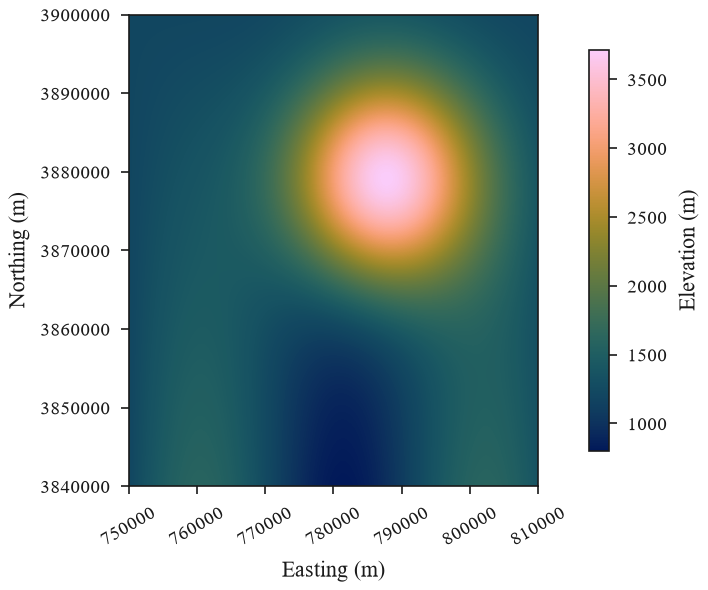

# Large rasters

A map printed 90 mm wide at 600 dpi shows about 2 100 pixels across, however large the
raster is. `fit_raster` reduces a raster to the pixels the printed figure needs before it
is plotted, so very large rasters fit in memory, plot quickly and give small vector PDFs.

```python
import eofigs

with eofigs.style("elsevier", font="serif"):
    fig, ax = eofigs.new_figure("single", height_mm=75)
    small = eofigs.fit_raster("dem_10m.tif", width_mm=90, height_mm=75, dpi=600)
    elevation = eofigs.variable("elevation")
    image = small.plot.imshow(ax=ax, cmap=elevation.cmap, add_colorbar=False)
    fig.colorbar(image, ax=ax, label=elevation.label, shrink=0.85)
    eofigs.save_figure(fig, "figures/fig1")
```



In this example a 6000 x 6000 raster (36 million pixels) becomes 2000 x 2000 pixels, the
resolution of a 90 mm map at 600 dpi.

## How rasters are reduced

| Data | Reduction | Chosen when |
|---|---|---|
| Continuous values | mean of the valid source pixels | default |
| Classes (land cover) | most frequent class | `kind="categorical"`, `flag_values` attributes, a GeoTIFF colour table, or a categorical library variable |
| Masks (for example p < 0.05) | fraction of True source pixels | `kind="mask"` or boolean data |

- Nodata and NaN pixels are ignored. An output pixel with fewer than `min_valid`
  (default 0.5) valid source pixels is set to NaN.
- **Significance is never averaged as p-values.** Reduce the significance mask instead
  (`kind="mask"`); the result is the fraction of significant source pixels in each printed
  pixel. Recipes dot a printed pixel when that fraction reaches a threshold (default 0.5).
- The output always has at least as many pixels as the print needs, and rasters are never
  upsampled.
- The CRS is required and kept; the transform is updated to the new pixel size. eofigs
  never assumes a CRS.

## Files and memory

GeoTIFFs and COGs are read with rasterio at the output size, so GDAL uses the file's
overviews when it has them and never loads the full-resolution array: a 10 000 x 10 000
GeoTIFF without overviews is reduced to a double-column map (4488 x 4488 pixels at 600 dpi)
in about 1.5 seconds. Pre-built overviews keep the resampling they were built with (often
nearest or average), which then applies instead of `kind`. For 8-bit files, averages are
computed exactly by eofigs, a few rows at a time, because GDAL rounds averages of 8-bit
data to whole numbers.

xarray inputs, including dask-backed arrays from `rioxarray.open_rasterio(..., chunks=True)`,
are aggregated by an integer factor and stay lazy; up to factor - 1 edge rows and columns
(less than one printed pixel) are dropped so the grid stays regular.
