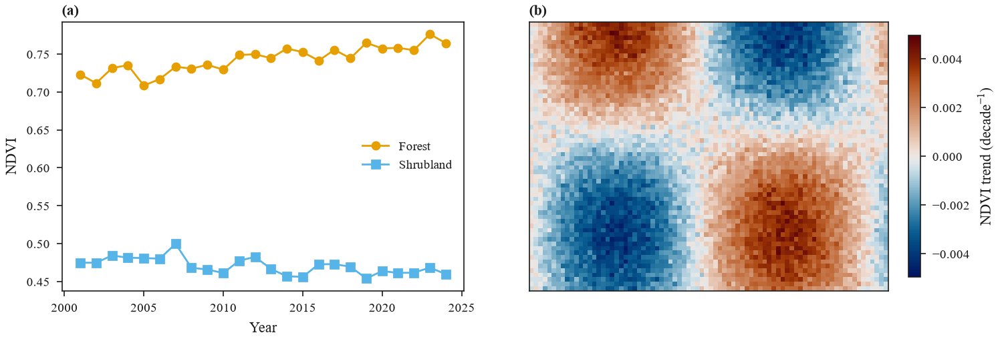

# Style and export

Every eofigs figure starts from the printed size. Choose a journal, create the figure at a
column width in millimetres, and save it in the journal's formats with a check report.

```python
import cmcrameri.cm as cmc
import numpy as np

import eofigs

rng = np.random.default_rng(42)
years = np.arange(2001, 2025)
ndvi_forest = 0.72 + 0.002 * (years - 2001) + rng.normal(0, 0.01, years.size)
ndvi_shrub = 0.48 - 0.001 * (years - 2001) + rng.normal(0, 0.012, years.size)
y, x = np.mgrid[0:60, 0:80]
trend = 0.004 * np.sin(x / 12) * np.cos(y / 15) + rng.normal(0, 0.0004, (60, 80))

with eofigs.style("elsevier", font="serif"):
    fig, (ax1, ax2) = eofigs.new_figure("double", height_mm=65, ncols=2)

    ax1.plot(years, ndvi_forest, marker="o", label="Forest")
    ax1.plot(years, ndvi_shrub, marker="s", label="Shrubland")
    ax1.set_xlabel("Year")
    ax1.set_ylabel("NDVI")
    ax1.legend(loc="center right")

    limit = np.abs(trend).max()
    image = ax2.imshow(trend, cmap=cmc.vik, vmin=-limit, vmax=limit)
    ax2.set_xticks([])
    ax2.set_yticks([])
    fig.colorbar(image, ax=ax2, label=r"NDVI trend (decade$^{-1}$)", shrink=0.9)

    eofigs.label_panels([ax1, ax2])
    report = eofigs.save_figure(fig, "figures/fig2")  # fig2.pdf + fig2.tiff for Elsevier
    print(report)
```



The check report for the live figure:

```text
Figure check (elsevier): passed
  PASS  size: 190.0 x 65.0 mm (double width).
  PASS  resolution: 600 dpi (at least 500 needed).
  PASS  font size: Smallest text 7 pt (minimum 7 pt).
  PASS  fonts: Fonts in use: Times New Roman.
  PASS  colour-blind safety: 2 categorical colours, all distinguishable.
  PASS  colour maps: Colour maps: vik (diverging).
```

`save_figure` adds the same checks for each written PDF, PNG or TIFF file, including the
fonts embedded in the PDF.

## Styles

`set_style` applies a journal style for the rest of a script; `style` does the same inside a
`with` block and restores matplotlib's settings afterwards, which keeps notebooks clean.

| Setting | Default |
|---|---|
| Font | the journal's preferred family; `font="serif"`, `"sans-serif"` or a font name |
| Fallback fonts | Times New Roman → Liberation Serif → TeX Gyre Termes; Arial → Liberation Sans → Arimo (a warning names the substitute) |
| Sizes | journal base size (8 pt), tick labels 1 pt smaller but never below the journal minimum |
| Units and symbols | matplotlib mathtext, matched to the text font (STIX for serif, DejaVu Sans for sans-serif) |
| Bold | `bold=True` for Times New Roman Bold–style figures |
| Colours | Okabe–Ito for lines and markers; cmcrameri `batlow` for images |
| Panel labels | `labels="(a)"`, bold; `"a"`, `"(A)"`, `"A"`, `"a)"` or `None` |
| PDF fonts | TrueType (Type 42), never Type 3 |

Write units with mathtext, for example `r"gC m$^{-2}$ yr$^{-1}$"`, not with Unicode
superscripts: some journal fonts have no glyph for "⁻¹" and print an empty box.

## Sizes

`new_figure` takes a named width (`"single"`, `"onehalf"`, `"double"`) or a number in mm,
and a height in mm or an aspect ratio. Heights above the journal maximum raise an error.
`save_figure` never trims the figure, so the file has exactly the printed size; use
`size_px=` when a fixed pixel width is required.

## Figure check

`check_figure` works on a live figure or on an exported file.

| Check | Rule |
|---|---|
| Size | width matches a column width (warning otherwise); not wider or taller than the journal allows |
| Resolution | at least the journal's resolution for figures with text and images |
| Font size | smallest text at least the journal minimum |
| Fonts | fonts in use (live figure) or embedded (PDF); Type 3 fonts fail |
| Colour-blind safety | line, marker, bar and fill colours differ by CIEDE2000 ≥ 10 in normal vision and ≥ 6 under simulated protan, deutan and tritan vision (Machado et al. 2009); close pairs are a warning, because markers, line styles or direct labels can separate them |
| Colour maps | sequential maps need monotonic lightness, diverging maps monotonic lightness on each side of the centre, cyclic and categorical maps are exempt; rainbow-type maps (jet, rainbow, hsv, turbo, ...) fail |
