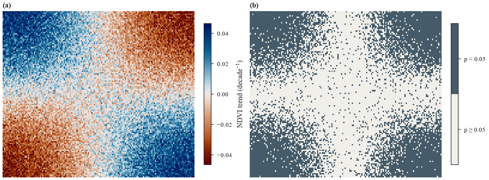

# Trends

`trend` computes a Theil–Sen slope and a Mann–Kendall test for every pixel of a time series
cube, against the real dates.

```python
import eofigs

result = eofigs.trend(ndvi_cube, per="decade")  # time, y, x -> y, x
result.slope  # NDVI per decade
result.significant  # p < 0.05
```



The figure shows a synthetic annual NDVI series (2000–2024) with greening and browning
regions and noise: (a) the Theil–Sen slope with the library's trend colours, (b) the pixels
where the Mann–Kendall test gives p < 0.05.

## Output

| Variable | Meaning |
|---|---|
| `slope` | median of all pairwise slopes, in data units per `per` (`"decade"` or `"year"`) |
| `intercept` | median of `y - slope * t`: the value at the first date, stored in its `reference_time` attribute |
| `pvalue` | two-sided Mann–Kendall p-value |
| `significant` | `pvalue < alpha` (default 0.05) |
| `n_valid` | number of valid observations |

Pixels with fewer than `min_valid` observations (default 8) are NaN. Spatial coordinates
and the CRS are kept, so the result plots directly as a map. The slope is labelled as a trend
of the input variable (for NDVI: "Normalized Difference Vegetation Index trend",
decade$^{-1}$), so `eofigs.variable(result.slope)` returns the variable's trend with
zero-centred colours.

## Method and assumptions

- **Time:** slopes use the datetime coordinate converted to years, so gaps and irregular
  steps are handled. A time axis that is not datetime64 raises an error.
- **Theil–Sen** slope (Sen 1968) and intercept as in `scipy.stats.theilslopes(method="joint")`;
  the tests compare both with SciPy for every pixel.
- **Mann–Kendall** test (Mann 1945; Kendall 1975) with the tie correction of the variance and
  the continuity correction of Z.
- **Assumptions:** observations are treated as serially independent; no correction for
  autocorrelation (modified Mann–Kendall, prewhitening) and no seasonal test are applied in
  this version. Deseasonalise or aggregate monthly data to annual values first; a seasonal
  Mann–Kendall test is planned for v0.2.

## Memory and time

The pairwise slopes are processed in blocks of pixels that fit `memory_mb` (default 256 MB),
so any series length works. The work grows with the number of pairs, n(n−1)/2, per pixel:

| Series | Pixels | One core | dask, 32 threads |
|---|---|---|---|
| 300 monthly steps | 20 000 | 37 s | 7.6 s |
| 300 monthly steps | 1 000 000 (extrapolated) | about 30 min | about 6 min |

Peak memory stayed near 400 MB for every size. For large cubes pass a dask-backed array
(for example `cube.chunk({"x": 500, "y": 500})`); the blocks then run in parallel. Annual
series are much faster: 25 steps have 300 pairs instead of 44 850. For long monthly series,
consider aggregating to annual values now; a seasonal Mann–Kendall test is planned for v0.2.

## References

- Sen, P. K. (1968). Estimates of the regression coefficient based on Kendall's tau.
  *Journal of the American Statistical Association*, 63, 1379–1389.
- Mann, H. B. (1945). Nonparametric tests against trend. *Econometrica*, 13, 245–259.
- Kendall, M. G. (1975). *Rank Correlation Methods*. Griffin, London.
